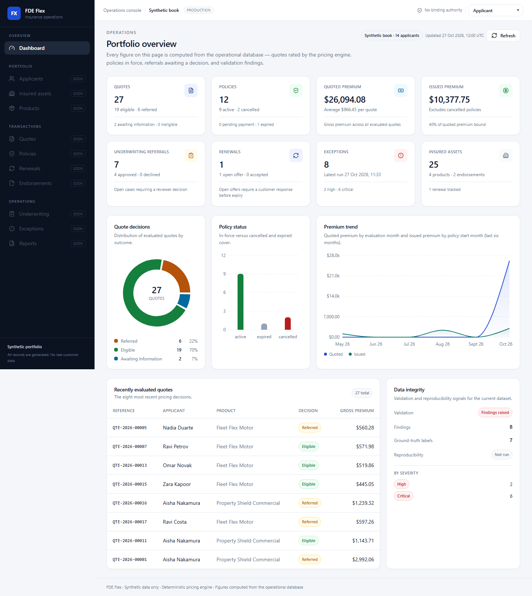

# FDE Flex — Insurance Operations & Risk Evaluation

An insurance operations workspace for **synthetic** applicants, assets, quotes, policies, endorsements,
renewals and underwriting referrals. Every figure in the UI is computed from PostgreSQL — there are no
hardcoded metrics — and every premium is produced by one deterministic pricing engine.

> All data is fictional and generated locally. No real customer information is collected or processed.



## Capabilities

| Area | What it does |
| --- | --- |
| Portfolio dashboard | KPI cards derived from live queries, quote/policy distributions, six-month premium trend, data-integrity panel |
| Record management | Searchable, filterable, paginated lists and detail views for applicants, assets, products, quotes, policies, endorsements and renewals |
| Quote evaluation | Validated request form → eligibility checks → deterministic rating → referral decision, with full breakdown |
| Underwriting | Referral queue with approve / decline / request-information actions, role + monetary authority enforced server-side |
| Data quality | 12 validation rule families, ground-truth linked findings, exception explorer with evidence and remediation |
| Reporting | Portfolio totals, findings by issue, reproducibility status, CSV/JSON/SQL exports |
| Auditability | Append-only audit events written in the same transaction as each state change |

## Technology

Next.js 16 (App Router, Cache Components) · React 19 · TypeScript strict · Tailwind CSS v4 ·
Prisma 6 + PostgreSQL 17 · Zod · React Hook Form · Recharts · Vitest · Playwright.

UI primitives follow the shadcn/ui pattern (Radix primitives + `class-variance-authority` + `tailwind-merge`)
and are vendored in `src/components/ui` rather than pulled through the shadcn CLI.

## Quick start

**Prerequisites:** Node.js 22 LTS, PostgreSQL 15+, npm.

```bash
# 1. Install
npm install

# 2. Configure (never commit .env)
cp .env.example .env        # Windows: copy .env.example .env
#    set DATABASE_URL / DIRECT_URL / TEST_DATABASE_URL

# 3. Create the schema
npm run db:migrate          # prisma migrate deploy (applies prisma/migrations)

# 4. Generate the synthetic portfolio (DESTRUCTIVE: truncates the target database)
npm run db:seed             # full scale, seed 20261001, label "baseline"

# 5. Run
npm run dev                 # http://localhost:3000
```

`npm run db:seed` and `npm run data:generate -- --reset` truncate the database they point at. They refuse to
run when `NODE_ENV`/`APP_ENV` is `production`, and refuse any database whose name does not contain
`insurancelab`. **Never point a reset at a database holding data you need.**

### Environment variables

| Variable | Required | Purpose |
| --- | --- | --- |
| `DATABASE_URL` | yes | Pooled runtime connection string |
| `DIRECT_URL` | no | Direct connection for migrations (managed providers) |
| `TEST_DATABASE_URL` | for tests | Dedicated test database; Vitest refuses to start without it |
| `APP_ENV` | no | `development` \| `test` \| `production`; reset guard reads it |
| `DEMO_AUTH` | no | `false` disables the demo role switcher (set this in any real deployment) |
| `NEXT_PUBLIC_APP_URL` | no | Absolute base URL for server-side API calls (otherwise derived from request headers) |

## Commands

| Command | Description |
| --- | --- |
| `npm run dev` | Development server |
| `npm run build` / `npm start` | Production build / serve |
| `npm run lint` | ESLint |
| `npm run typecheck` | `tsc --noEmit` |
| `npm test` | Unit + integration suites (Vitest) |
| `npm run test:e2e` | Playwright suite (starts the app on `E2E_PORT`, default 3000) |
| `npm run db:migrate` | Apply migrations (`prisma migrate deploy`) |
| `npm run db:seed` | Full-scale dataset (destructive) |
| `npm run data:generate -- --seed 42 --scale small` | Custom generation |
| `npm run data:validate -- --label baseline` | Run validation, persist findings, write a report |
| `npm run data:export -- --label baseline --out data/exports/x` | CSV/JSON/SQL bundle + checksums |
| `npm run data:compare -- <dirA> <dirB>` | Byte comparison; writes `data/reproducibility.json` |
| `npx tsx scripts/capture-evidence.ts` | Read-only snapshot of the current dataset + latest validation |

## Architecture

```
src/app            App Router pages + REST route handlers
src/services       Business transactions (quote, policy, endorsement, renewal, underwriting)
src/lib/pricing    The single premium formula (engine.ts)
src/lib/business-rules  Eligibility, referral thresholds, risk-factor matching
src/lib/lifecycle  Explicit state machines for every entity
src/lib/validation 12 rule families + ground-truth evaluation
src/lib/generator  Seeded synthetic data + labelled anomaly injection
src/lib/exports    Deterministic projections, CSV, canonical JSON, master-data SQL
prisma/            Schema + migration
scripts/           Generator, validator, exporter, reproducibility, evidence capture
```

Details: [docs/architecture.md](docs/architecture.md) · [docs/data-dictionary.md](docs/data-dictionary.md) ·
[docs/business-rules.md](docs/business-rules.md).

### Design decisions worth knowing

- **One pricing implementation.** `src/lib/pricing/engine.ts` is used by generation, the API and the validator.
  No UI or route handler performs premium arithmetic.
- **Decimal money.** `NUMERIC(14,2)` in PostgreSQL and `decimal.js` in code; intermediate rating values keep 6dp
  and the payable amount is rounded HALF_UP to 2dp exactly once.
- **Snapshots over recomputation.** Each quote stores its pricing breakdown *and* the inputs it was rated from,
  so the validator can re-derive the premium even after rate tables change.
- **Append-only audit.** Policy/quote/decision transitions write `AuditEvent` rows inside the same transaction.
- **Business references, not surrogate ids.** `QTE-2026-00032` is stable and appears in exports; cuid columns stay internal.
- **Ground truth is separate.** `AnomalyLabel` rows are written by the generator and read only by the evaluation
  step — never by the checks themselves ([docs/anomaly-labels.md](docs/anomaly-labels.md)).

## Data model

11 core entities with bridge tables `QuoteCoverage` and `QuoteRiskFactor`. Highlights:

- `Applicant 1—N InsuredAsset`, `Applicant 1—N Quote`, `Applicant 1—N Policy`
- `Product 1—N CoverageOption`, `Product 1—N RiskFactor` (nullable product = global factor)
- `Quote 1—N QuoteCoverage`, `Quote 1—N QuoteRiskFactor`, `Quote 1—1 Policy`
- `Policy 1—N Endorsement`, `Policy 1—N Renewal`, `Renewal 0—1 Policy` (successor)
- `Quote 1—N UnderwritingDecision`

Full field-level dictionary, constraints and lifecycle states: [docs/data-dictionary.md](docs/data-dictionary.md).

## Business rules

- Eligibility: product status and effective window, applicant age band, asset category and value band,
  mandatory coverages, per-option and total coverage limits.
- Rating: `Σ(limit/1000 × baseRate × coverageFactor) × Π(riskMultipliers)`, floored at the product minimum premium.
- Referral: premium above threshold, coverage above the auto-bind limit, or any risk factor flagged as a referral trigger.
- Issuance: eligible (or approved) quote, confirmed payment, no overlapping coverage for the asset, role authority ≥ premium.
- Endorsements/renewals: state guards, effective-date checks, recalculated premium deltas, cancelled policies excluded.

Full detail and worked examples: [docs/business-rules.md](docs/business-rules.md).

## Validation and anomalies

`npm run data:validate` runs 12 check families (duplicates, completeness, referential integrity, enumerations,
date ordering, lifecycle, premium formula, monetary reconciliation, coverage limits, renewals, overlaps, risk data).
Each finding carries a stable issue code, entity reference, severity, expected/observed values and a remediation.

The generator deliberately injects **7 labelled anomalies** and writes matching `AnomalyLabel` rows. The checker
never reads those labels; the reporting step joins them afterwards to compute detection. Last recorded run:

| Metric | Value |
| --- | --- |
| Checks executed | 12 |
| Findings | 8 |
| Labelled anomalies detected | 7 / 7 |
| Unexplained findings | 0 |

One anomaly can legitimately produce more than one finding (an unpaid active policy also violates issuance rules).

## Reproducibility

```bash
# Two fully independent databases, same seed
npm run data:generate -- --reset --scale small --seed 20261001 --label repro-a
npm run data:export -- --label repro-a --out data/repro/run-a
# ...repeat into a second database / directory...
npm run data:compare -- data/repro/run-a data/repro/run-b
```

Last verified result: **11 checksums and all deterministic files match byte-for-byte** for two independent
databases at seed `20261001` (dataset checksum `b2f5dc44…`). Files expected to match: everything in `json/`,
`csv/`, `checksums.json`, `ground-truth/labels.json`, `sql/master-data.sql`. The only volatile value is
`manifest.generatedAt`, which is excluded from comparison.

## Testing

```bash
npm test          # 84 tests, 7 files
npm run test:e2e  # 13 Playwright tests
```

Coverage map, isolation strategy and the exact results of the last run: [docs/testing.md](docs/testing.md).

## API

| Method | Path | Auth |
| --- | --- | --- |
| GET | `/api/health` | public |
| GET | `/api/dashboard/summary` | any |
| GET | `/api/reports/summary` | any |
| GET | `/api/applicants`, `/api/applicants/[id]` | any |
| GET | `/api/assets`, `/api/assets/[id]` | any |
| GET | `/api/products`, `/api/products/[code]` | any |
| GET | `/api/quotes`, `/api/quotes/[id]` | any |
| POST | `/api/quotes/evaluate` | `quote:evaluate` |
| GET | `/api/policies`, `/api/policies/[id]` | any |
| POST | `/api/policies/issue` \| `/activate` \| `/cancel` | `policy:issue` / `policy:cancel` + authority |
| GET/POST | `/api/endorsements`, `POST /api/endorsements/[id]/decision` | `endorsement:submit` / `endorsement:decide` |
| GET/POST | `/api/renewals`, `POST /api/renewals/generate`, `POST /api/renewals/[id]/respond` | `renewal:*` |
| GET | `/api/underwriting/queue` | any |
| POST | `/api/underwriting/decisions` | `underwriting:decide` + authority |
| POST | `/api/validation/run` | `validation:run` |
| GET | `/api/validation/latest?includeGroundTruth=true` | any |
| GET | `/api/exports/data?entity=&format=csv\|json\|sql` | `export:read` |
| GET/POST | `/api/session/role` | demo identity (see below) |

Errors are structured: `{ "error": { "code", "message", "details" } }` with 400/403/404/409/413/422/500.
Stack traces and connection strings are never returned.

## Security

Server-side authorization on every mutation, monetary authority limits per role, Zod validation on all input,
64 KB request cap, pagination cap of 100, and a health endpoint that exposes no secrets.
**The role switcher is a demo identity control, not authentication** — it sets an httpOnly cookie and must be
disabled with `DEMO_AUTH=false` and replaced with a real IdP before any production use.
Full review: [docs/security.md](docs/security.md).

## Deployment

Vercel + managed PostgreSQL (Neon/Supabase/RDS). Migration, seeding and smoke-test steps:
[docs/deployment.md](docs/deployment.md). No deployment has been performed from this repository.

## Known limitations

- Demo identity only; no password, SSO or session revocation.
- Underwriting queue is capped at 100 pending / 25 recent with no pagination.
- Exception explorer shows the latest validation run only; historical runs are not browsable in the UI.
- SQL export covers master data (products, coverage options, rating factors), not transactional tables.
- Single-currency (USD) presentation; no FX or tax handling.
- No rate limiting or CSRF token beyond `SameSite=Lax` cookies.
- Synthetic distributions are plausible, not actuarially calibrated.

## AI usage

This project was built with AI assistance. The disclosure, prompt history and the split between generated and
manually verified work are recorded in [docs/ai-usage.md](docs/ai-usage.md).
